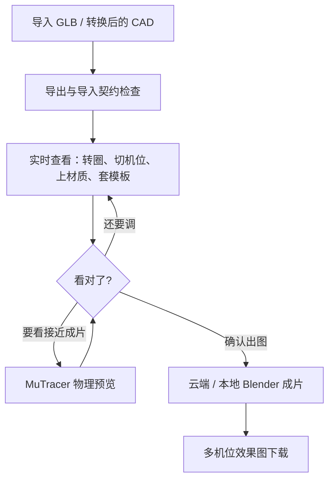

# Blender Web 3D × MuTracer 融合设计

> 2026-11-10 Bano 决策：把 [Blender Web 3D](https://github.com/czlonkowski/blender-web-3d-skill) 与 MuTracer 融合，纳入可影 2.0 接下来的功能推进。本文是融合点设计与落地、验收依据。
>
> 阅读对象：MuTracer-POC（落地）、Koa（验收）。
>
> 配套文档（先读再改）：
> - `docs/prd/可影2.0-需求说明.md`（产品主链与预览/成片边界）
> - `docs/technical/dual-track-render.md`、`tools/dual-track/README.md`（现有双轨）
> - `tools/scene-template/README.md`、`docs/technical/scene-template-fusion-scout.md`（模板合并边界）
> - `tools/dual-track/stage_semantics.md`（预览与成片共用的场景约定）
>
> 本文只写入文档目录，不自动提交。实现按本仓库现有习惯出分支或提交，由 POC 执行、Koa 验收。

---

## 1. 一句话定位

可影仍然卖「棚拍壳 + 云端出图 + 文件可下载」。MuTracer 仍然是**接近成片的物理预览**；Blender Cycles 仍然是**成片**。Blender Web 3D 补上两块现有双轨没有做好的能力：

1. 导入/导出时，零件名、材质名、转动枢轴不被优化流程洗掉；
2. 设计师在确认出图之前，先有一层**能流畅交互的实时查看**，用来看机位、材质、模板对不对。

实时查看不是成片，也不能替代 MuTracer 预览。三层必须同时存在，而且要共用同一份场景状态。

## 2. 不要动的边界

- 不把 Three.js 实时画面说成成片，不对外交付实时截图冒充效果图。
- 不把可影做成「发布一个独立网页展厅」。那是 Blender Web 3D 自己的产品形态，不是可影的交付形态。
- 不在 MuTracer viewer 里重造场景模板合并语义（`replace_id`、占位替换、views）。合并仍在可影语义层（已有 `tools/scene-template`），viewer 只消费合并结果。
- 不把 Living Room 等 preset 改名叫场景模板。它们仍是房间/环境资产。
- 不因这次融合改写定版主链的顺序：导入（GLB/FBX 直进或 CAD 先转换）→ 查看 → 上材质 → 套场景模板 → 浏览器预览 → 确认后渲染 → 导出效果图 → 多机位出图。融合是插进「查看 / 预览 / 导出纪律」里，不是另开一条产品。
- 不把 MuTracer 现有的 `previewEnabled`（路径追踪过程中的低分辨率预览）和本次「实时查看」混成一个开关。两者机制不同，UI 上要分开命名。

## 3. 三层预览 / 出图，共用一份状态

现有双轨是两层：

| 层 | 现在是什么 | 本次之后 |
| --- | --- | --- |
| 实时查看（新增） | 无。viewer 一加载就进入路径追踪，转视角成本高 | 默认先走光栅实时查看（合批、自适应画质、可选模板烘焙光），用来确认机位、材质、模板 |
| MuTracer 预览（保留） | `mutracer-render` / 8787，交互精度预览，**不是成片** | 同一相机、同一材质、同一合并后的 scene，切换到高质量预览 |
| Blender 成片（保留） | 无头 Cycles，`tools/dual-track/blender` | 确认后仍只走这一层出可下载效果图 |

三层都吃同一份 **scene JSON + asset map**（约定见 `stage_semantics.md`），以及同一套材质身份（色、金属、粗糙度、贴图、网格对应关系）。切换层时，不允许出现「实时里是黄铜、预览里变回浅灰」这类状态分叉。

## 4. 融合点设计

### F1 导入导出契约：「名字就是契约」

**问题。** Blender Web 3D 已经踩过的坑，和工业链里「网格导出会洗白基色」是同一类：`gltf-transform` 的 `flatten()` / `prune()` 会删掉靠 JS 驱动的枢轴；`palette()` 会抹掉着色器用的材质名；量化几何会让按米写的着色细节失效。可影要按零件上材质、按 `replace_id` 换品、按模板视图切机位，一旦名字和枢轴在导出或再次优化时丢失，后面全线都会默默错。

**设计。**

- 建立一份「可影 / MuTracer 导入导出契约」，作为官方预设，而不是每次口头提醒：
  - 必须保留：网格 / 节点名、Blender 或源文件中的材质名、名称含 `Pivot` 的转动节点、相机名、用于替换的占位或 `replace_id` 对应节点。
  - 允许做：Draco / meshopt / 纹理压缩、静态合批——但合批不得越过动画或枢轴祖先，不得把不同材质合并到丢掉名字。
  - 禁止在默认路径使用会破坏上述名字的 `flatten` / `prune` / `palette`。若某条优化必须开，要在校验里显式失败，而不是导出一份看起来很小却绑不上材质的 GLB。
- 导入时做一次契约检查，把结果告诉用户或日志：缺材质名、枢轴被拍平、仅有默认材质、占位节点找不到。
- 契约同时约束「进编辑器的模型」和「成片轨道再导出的网格」。预览轨道和成片轨道的材质身份继续走 `stage_semantics.md`，不得各写一套别名。

**落地位置。** 优先做在导入链和 dual-track 使用的 GLB 准备步骤上（转换脚本、官方导出预设、导入校验），不要先改路径追踪内核。

**验收。** 用一份带命名材质和转动枢轴的样件（优先可影冰箱/洗衣机或工业减速器，不要用 Living Room），完整走过「优化导出 → 导入 viewer → 按名绑材质 → 套模板或切机位」。优化后文件仍保留材质名和枢轴；实时查看和 MuTracer 预览绑到同一套材质；不允许再出现「导出后基色被洗白」且无报错。

### F2 实时查看接入 viewer，与物理预览并存

**问题。** 定版主链要求「浏览器预览 → 确认后渲染」。现在的预览几乎一进就是 MuTracer 路径追踪，微调机位和材质时反馈偏重。设计师需要先快速看对，再切到接近成片的预览。

**设计。**

- 在现有 viewer 增加明确的两种查看模式，不要借用现有 `previewEnabled` 这个名字：
  - **实时查看**：光栅、可流畅转圈，采纳 Blender Web 3D 的合批、自适应画质、`compileAsync` 后再揭开画面、按需更新阴影等经验。
  - **高质量预览**：现有 MuTracer 路径追踪预览，行为保持预览轨道语义。
- 默认进入实时查看；提供一键切到高质量预览。切换时继承：当前相机 / 视图、物体显隐、已赋材质、已合并的模板结果。
- 场景模板栏（右栏已规划 / 部分落地的「场景模板」）选模板并合并后，先在实时查看里看到结果，再允许进高质量预览或提交成片。
- 实时查看可以比成片更「亮」、更干净，但材质身份和相机不得分叉。

**落地位置。** `viewer` 的 Viewport / 渲染设置。实时查看应复用已加载的 Three 场景或同一份 scene 状态，而不是另开一个只读演示站。不要引入「导出独立展厅 HTML」作为本阶段范围。

**验收。**

- 同一份已合并场景，实时查看下切正视图 / 特写，再切高质量预览，相机与材质一致。
- 套模板后，实时查看可在短时间内开始交互（目标：普通单品 + 模板在开发机上约 2 秒内可转，超时要有原因，不要假死）。
- UI 文案上能分清「实时查看 / 高质量预览 / 提交渲染」，没有把实时画面标成「效果图」或「成片」。

### F3 场景模板预烘焙光照

**问题。** 品牌空间模板如果只靠实时光或等路径追踪出第一张，套上产品后「立刻像那么回事」做不到。Blender Web 3D 把 Cycles 烘焙成 HDR lightmap（UV2）再给实时查看用，正好适合模板壳。

**设计。**

- 烘焙对象是**模板壳**（环境、空间、棚），不是被替换进去的产品。产品继续用自己的材质，吃模板的灯光或烘焙环境，但不把自己的 shading 烤死在模板图里。
- 烘焙结果随模板资产走（例如模板目录下的 lightmap / IBL 立方体），合并 `scene.json` 时由模板带入；产品换掉占位后，壳上的烘焙仍在。
- 实时查看优先用这套烘焙；高质量预览和成片仍用模板里的物理灯 / 环境（HDRI、灯光实体），不把 lightmap 当成成片光源的唯一来源，以免两套光打架。若某模板没有烘焙资产，实时查看回退到普通实时光，不能报废模板。
- 已知模板合并缺口（`meshes[*].url` 未改写、`views` 未 remap 新根 id）要在启用烘焙前先避开或先修，避免烘焙贴到错误网格上。能修则修，不能修就在本阶段不用该模板做验收。

**落地位置。** 模板资产约定 + 实时查看读取 UV2 / IBL；不把烘焙逻辑写进 `merge_scene_template.mjs` 的占位替换里。合并层只负责把模板字段带过去。

**验收。** 同一模板、同一产品：无烘焙 vs 有烘焙，实时查看里空间光感明显不同；替换产品后壳的光还在、产品材质不被烤成壳的颜色；切到高质量预览 / 出一张成片时，不以 lightmap 替代 Cycles 灯光。

### F4 材质身份与色彩管理对齐

**问题。** 三层如果各自调色，设计师会不信任预览。现有双轨已经规定：预览和成片共用 scene 里的颜色、金属、粗糙度、贴图；Blender 成片对少数冰箱零件有特殊情况，路径追踪预览不能随便复用成片的 HDRI 强度算法。Blender Web 3D 强调两边都走 AgX，并用材质名做着色器补丁。

**设计。**

- 实时查看的色调映射默认与 viewer 已有的 AgX 对齐，避免再引入第三套电影曲线。
- 材质补丁（例如按材质名给金属、玻璃加一点程序细节）只能作为实时查看的增强，且必须键在契约保留的材质名上。高质量预览和成片仍以 scene PBR 为准，不把实时补丁偷偷带到成片。
- 已有的成片特殊材质（CAD 调试塑料、门边粉末涂料、近白抽屉、玻璃）继续只存在成片轨道，实时查看不要「发明」另一套特例，必要时用同一份身份表只读对齐。

**验收。** 选定 2–3 个已有样件材质（含一种金属、一种玻璃），三层并排对照：色相不乱跳，金属/玻璃能认出是同一套；实时查看允许更亮，但不把黄铜做成浅灰。记录对照图，供 Koa 验收。

### F5 性能与画质档

**设计。** 实时查看提供可理解的档位（例如流畅 / 标准），含自适应分辨率、合批、按需阴影。高质量预览沿用现有采样、降噪、分辨率设置，互不影响。大场景（模板空间 + 产品）在开发机上实时查看应可转圈，卡顿要能量化，不要只说「有点慢」。

**验收。** 用一份真实模板场景（优先厨房冰箱或洗衣机模板，不用 Living Room 充数）给出实时查看的帧时间和档位差异；切换档位不得丢掉材质名或相机。

## 5. 落地顺序（给 POC）

不要平行铺开五条。按下面顺序，A 绿了再上 B。全线编码仍走 DSH headless + Magpie `kiro/claude-sonnet-5.5`，禁止 Claude Code；Sonnet 全机硬并发为 1，若工厂占用席位，先做对照和方案细化，等席位空了再改代码。

| 次序 | 内容 | 完成标准 |
| --- | --- | --- |
| 第 0 步 | 对照本文与现有 viewer / dual-track / 模板代码，写一页「现状差在哪、改哪些文件」，发给 Koa 再动手 | 文件级差距表，不发明第二套场景格式 |
| 第 1 步 | F1 契约：官方导出预设 + 导入校验 | 第 4 节 F1 验收通过 |
| 第 2 步 | F2 实时查看模式，与高质量预览切换且状态同步 | 第 4 节 F2 验收通过 |
| 第 3 步 | F3 模板烘焙光（选一个已有 `replace_id` 的真模板） | 第 4 节 F3 验收通过 |
| 第 4 步 | F4 色彩与材质对照、F5 档位 | 对照图 + 简单性能记录 |

第 1、2 步是本轮要交验收的核心。第 3、4 步可以紧接着做，但不得倒过来先做好看的烘焙和 shader，却还在丢材质名。

## 6. Koa 验收清单

POC 交验收时，请按项给出证据（命令、日志、截图或对照图），不要只写「已完成」：

1. 文档与代码边界仍在：三层还在，成片仍是 Blender；没有独立展厅交付；模板合并没有搬进 viewer。
2. F1：命名材质 + 枢轴样件，优化导出后名字还在；导入校验能抓住一份被故意破坏的坏 GLB。
3. F2：实时查看 ↔ 高质量预览，相机和材质一致；文案不把实时图叫成片。
4. 若已做 F3：壳上有烘焙、产品不被烤色、成片仍走物理灯。
5. 若已做 F4：2–3 个材质的三层对照图，色相不乱跳。
6. 已知模板缺口（url、views remap）如未修，验收材料里写明避开了哪套模板、为什么。

Koa 只在清单有证据时收口；缺证据就退回，不改成「先上架再说」。

## 7. 与可影 2.0 主链的插入关系

- **导入：** F1 是主链第一步的质量门。
- **查看 / 上材质 / 套模板：** 先走 F2，模板光走 F3。
- **确认渲染 / 多机位导出：** 仍只进入 MuTracer 预览（可选）和 Blender 成片。实时查看的相机和视图预设必须能被成片轨道读到，否则多机位会错位。

本文不改变合同 13 项的验收分层，也不把 Motus 上的编辑器微调提前到本轮。
