# 可影 2.0（CoStage）需求说明

> 产品需求文档（PRD）。给后续在本仓库和 costage 上工作的同学、agent 一次看清产品，不必再反复口述。
>
> - 整理日期：2026-11-10
> - 整理人：Koa（按 Bano 口述与已确认口径整理，不增补未拍板功能）
> - 依据：
>   1. 2026-11-09 晚 Bano 与 Koa 当面沟通的可影 2.0 口径与定版主链
>   2. 2026-11-05 可影沟通原型 v2（`/Users/wangjianzheng/Doc/dyson/costage-proto-v2-pixel/`）及设计稿 `refs/工作台-*.png`
>   3. 《可影-沟通原型-用户旅程确认稿》《需求原型缺口对照》《3D编辑器待确认事项》
>   4. 《可影功能清单-合同验收标准》13 项
> - 文中截图均为官方设计稿或沟通原型页面，不是现网实现。原型本身是可点击的界面稿，中间预览区是静态效果图，不是实时渲染。
> - 本文只写入仓库文档目录，**不自动提交**。需要入库时再单独 commit。

---

## 1. 产品定位与功能总览

### 1.1 一句话

可影是给工业设计师用的在线产品可视化工作台：把产品模型放进棚拍或品牌空间里，在浏览器里查看、换材质、换场景、摆多机位，确认后交云端出图，并把效果图和交付文件下载下来。

对外交付形态（2026-11-09 定）：客户给需求，交付 **「棚拍壳 + 云端出图 + 文件可下载」**。

两件事不要说混：

- 浏览器里的预览（例如本机端口上的 MuTracer viewer）只是预览，用来确认机位、材质和场景对不对。
- 最终成片走云端渲染。不要把预览说成「MuTracer 已经替代 Blender」。金样对照仍以 Blender 成片为准，用来查噪点和参数问题。

### 1.2 谁在用、解决什么问题

主用户是工业设计师（沟通原型里的典型场景是海尔、卡萨帝等家电产品：洗衣机、干衣机等）。他们日常要做的不是从零建三维软件工程，而是：

- 拿到产品模型（三维文件或 CAD），尽快在标准灯光下看清楚产品本身；
- 给外壳、面板、玻璃、Logo 换上正确的材质和贴图；
- 把产品放进品牌已经定好的空间或灯光模板里，出一组多机位效果图；
- 把确认过的图和部件材质表整理成下游能看的交付物。

侧边栏里的「数字样机 / 套系阵容 / 营销图」在原型里是灰态入口，**本期不做**。

### 1.3 两层范围，不要混

| 层 | 是什么 | 用来验收什么 |
| --- | --- | --- |
| 合同级（给甲方） | 功能清单 13 项：规划设计、HWork、HID、输出与在线评审、资产元数据、工作台、CAD、Web3D 工作台、渲染引擎、GPU 调度、VR（本期不做）、AI Agent / MCP、管理运维安全 | 合同是否交付 |
| 本周定版技术主链（内部打底） | 2026-11-13 前锁「定版方案」= 主链跑通。原 12-05 计划作废 | 技术路线能不能撑住上面的卖法 |

**定版主链（必须按这个顺序讲）：**

导入三维文件（GLB / FBX 直接进编辑器）或 CAD（如 STP，先转换成可解读格式再进编辑器）→ 在编辑器里查看 → 上材质 → 选用场景模板并合并 → 浏览器预览 → 确认后渲染 → 导出效果图 → 摆多机位相机 → 导出各机位效果图。

POC 跑通之后，再结合实际使用场景，在 Motus 上对 3D 编辑器做功能微调。那一步**不是本周定版范围**。

技术 POC 只作内部打底，**不能代替合同项**。合同看板必须按 13 项跟踪，不能用「冰箱场景预览已经能看」代替「CAD 导入 / Web3D 工作台 / 渲染回传 / GPU 调度可视」这些合同验收。

### 1.4 主路径总图

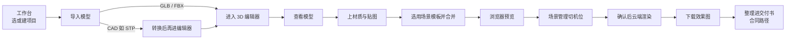

### 1.5 页面地图

工作台是设计师每天进系统后的家。从这里进入编辑器、看历史渲染、从画廊复用别人的文件。编辑器是干活的主界面。交付书、资产管理、运营看板是同一产品里的另外几页，不是编辑器里的一个面板。

| 页面 | 设计师做什么 |
| --- | --- |
| 工作台 · 我的文件 | 按项目看自己的文件，从本地 / NAS / 模板创建单品或场景渲染 |
| 工作台 · 所有渲染 | 跨项目看已经渲完的效果图，可筛选 |
| 工作台 · 画廊优选 | 看优秀案例，可「套用该文件」开始自己的工作 |
| 3D 编辑器 | 查看、上材质、管场景视角、套模板、布光、提交渲染 |
| 交付书 | 把方案预览和部件材质参数整理成下游可读的一页，可导出 PDF |
| 资产管理 | 管理单品模板、场景模板、材质、贴图、模型、灯光、环境、动画等库 |
| 运营看板 | 看用量、人数、GPU 时长（管理侧，不是设计师主路径） |

### 1.6 三个必须分清的概念

后面所有功能都建立在这组定义上，不要把词用混。

1. **单品渲染 vs 场景渲染**
   - 单品渲染：拍的是产品本体。标准机位、标准灯光，重点看形体、材质、细节，背景通常是干净棚拍。
   - 场景渲染：把产品放进品牌空间里再渲，灯光、环境、相机都跟着空间走。
2. **场景模板 ≠ 场景管理 ≠ 房间资产**
   - **场景模板**：一整套「壳」。里面有产品占位（用 `replace_id` 标记要被换成当前产品的位置），选用后把当前产品合并进模板的 `scene.json`。灯光、相机、环境、视图预设都随模板过来。**不是只换一张背景图。**
   - **场景管理**：还在同一份已打开的场景里，在「正视图 / 左视图 / 特写」这些已经保存好的视角之间切换。
   - **房间 / 环境资产**：例如 MuTracer 现在的 Living Room 等 preset，只是演示用的房间模型，没有占位换品能力。2026-11-09 已定：它们降级为「房间 / 环境资产库」，给模板壳当素材用；**不要改名叫「场景模板」。** 场景模板要做在 viewer 右侧新开的「场景模板」栏里。
3. **预览 vs 成片**
   - 预览：浏览器里实时或近实时看到的结果，用来确认对不对。
   - 成片：确认之后交云端渲染出来的可下载文件。

### 1.7 导入原则（2026-11-09 定）

- 可导入 **3D 相关格式**和 **CAD 相关格式**。
- 3D 格式（如 GLB、FBX）可以直接进编辑器。
- CAD（如 STP）走转换路径，变成可解读的三维格式后再加载。
- 口头里曾出现的「JRF / JRB」是口误 / 转写错误，实际指 **GLB**。按 GLB（另有 FBX / STP）处理，不要再按 JRF/JRB 设计格式。

### 1.8 渲染架构方向（2026-11-09 定）

先查清当前渲染噪点是引擎问题还是参数问题，对照三个样品（Blender 金样 vs 可影渲染）逐项比。同时评估用新的基础架构替换 UE 云流。**用户流程不变**：导入模型 → 上材质 → 场景替换 → 浏览器预览 → 确认后渲染。

---

## 2. 工作台

工作台是进入可影之后的第一屏。顶部仍在 Hi-work 里，左侧是可影自己的导航，中间是三个页签：**我的文件 / 所有渲染 / 画廊优选**。

### 2.1 我的文件

**用户场景**

设计师早上打开可影，要继续改「2025 新款卡萨帝-HG-AI」里昨天没渲完的浅色方案，或者为同一个项目新建一个文件。她不希望先翻资产管理，而是直接在自己的项目分组里看到最近编辑过的缩略图，点进去就能进编辑器。

另一个入口是从空白开始：她手里有一份本地模型，或 NAS 上已有模型，或只想先建一个空白文件再导入。

**功能描述**

- 页面上半是创建区，分成两块，对应两种渲染意图，不能合成一个按钮：
  - **创建单品渲染**：从本地模型创建、从 NAS 模型创建、空白文件创建。适合先把产品本体看清楚、上材质。
  - **创建场景渲染**：从本地模板创建。适合已经选好空间模板、要把当前产品放进去。
- 旁边是教学文档和问题反馈入口，方便新手和提缺陷，不属于主生产路径。
- 下半是「按项目分组」的文件墙。每个项目是一组卡片，卡片展示缩略图、文件名、上次编辑或渲染完成时间。
- 列表可按「最新编辑」等规则排序；右侧有「新建项目」。
- 点卡片进入对应的 3D 编辑器文件。

**原型截图（设计稿 工作台 / 工作台-6，我的文件）**

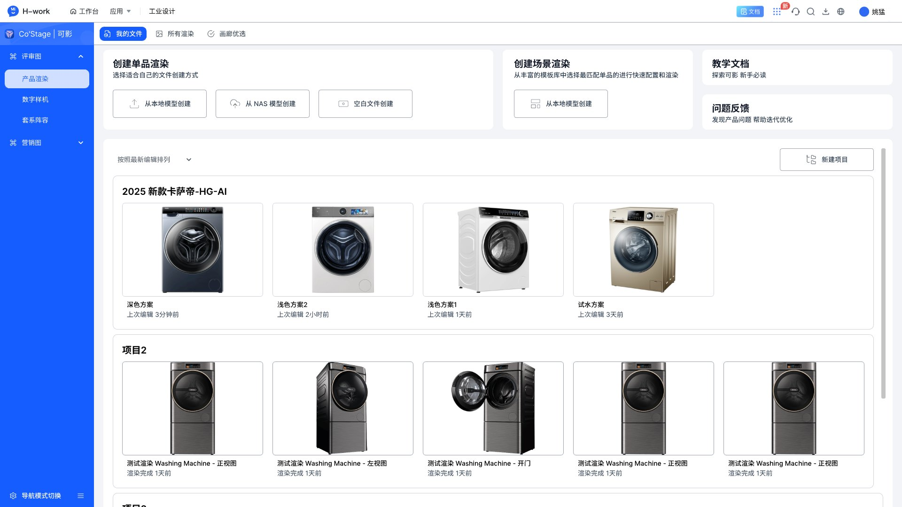

### 2.2 新建项目与套用文件

**用户场景**

设计师点了「从本地模型创建」，系统先问：这次渲染要挂在已有项目下，还是新建一个项目。项目名称来自业务侧已有的项目清单（原型示例是「HG-滚筒洗衣机2024-A01」这类编码），不要让每个人随便起一个对不齐的名字。

画廊里看到别人做过的优秀文件时，她也可以「套用该文件」，相当于带着既有灯光、机位、材质配置开始，而不是从空白棚开始。

**功能描述**

- 创建弹层包含两步：输入或选择「新建项目」；或从「选择已有项目」下拉里选一项后开始渲染任务。
- 「套用该文件」与「从模板创建」是同一类动作：带着已有配置生成新文件，不覆盖别人的原文件。
- 若本地还没有把模型带进来，接下来会进入打开文件对话框（见 3. 导入）。

**原型截图（设计稿 工作台-7，创建项目弹层）**

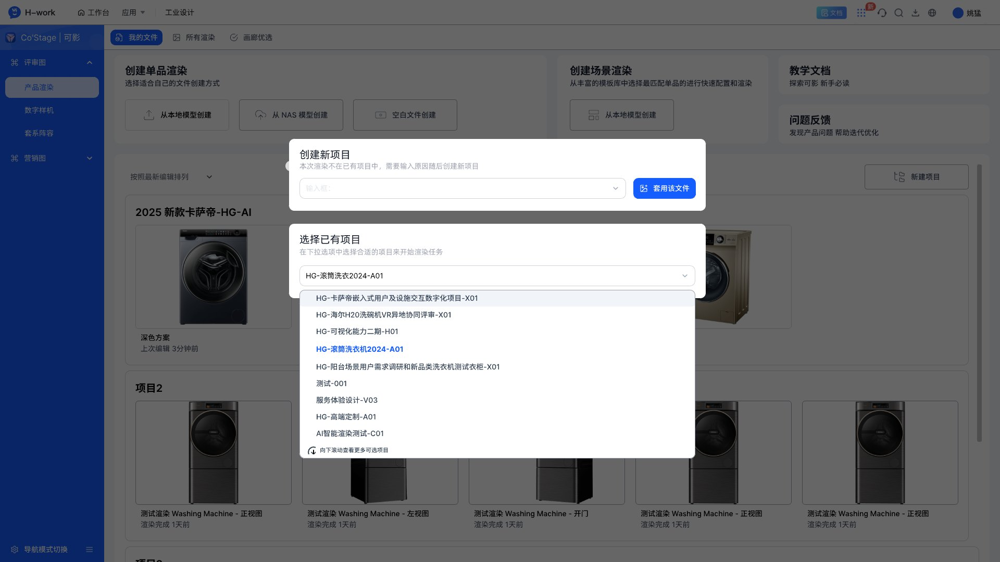

### 2.3 所有渲染

**用户场景**

设计师或项目负责人要在多个文件、多个项目之间找「上周渲完的那张开门图」，按品牌、品类、时间把历史成片筛出来，而不必先记得它存在哪个项目文件夹里。

**功能描述**

- 独立页签，展示已完成（及将来应展示进行中 / 失败，见第 10 节缺口）的渲染图，按网格陈列。
- 可按关键词、人员、时间、品牌、项目等过滤，可重置筛选。
- 卡片展示缩略图、标题、完成时间。点击后应能回到对应文件或查看大图（沟通原型主路径可点，任务态仍是缺口）。

**原型截图（设计稿 工作台-4，所有渲染）**

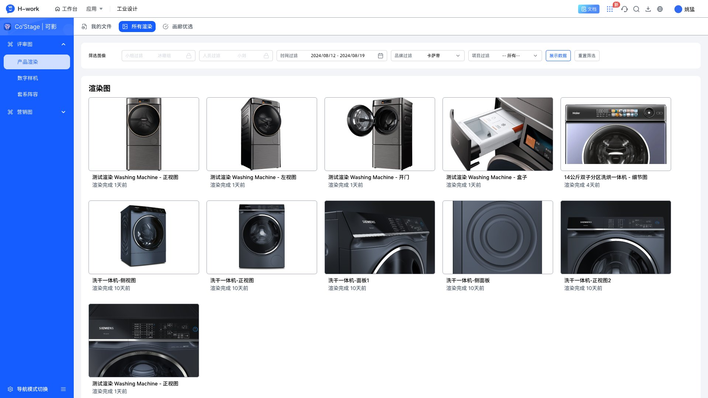

### 2.4 画廊优选

**用户场景**

设计师要做一件卡萨帝滚筒的场景图，不想从零搭空间。她在画廊里按品牌、品类筛选，看到「滚筒洗衣机场景 238 改」这类已验证过的案例，确认风格对得上之后，点「套用该文件」进入自己的项目继续改。

**功能描述**

- 画廊是优选案例墙，不是个人文件箱。筛选维度包括品牌、品类等。
- 卡片可展示作者、时间、标题；悬停出现「套用该文件」。
- 套用后应进入创建 / 选项目流程，生成属于当前用户的新文件。

**原型截图（设计稿 工作台-5，画廊优选）**

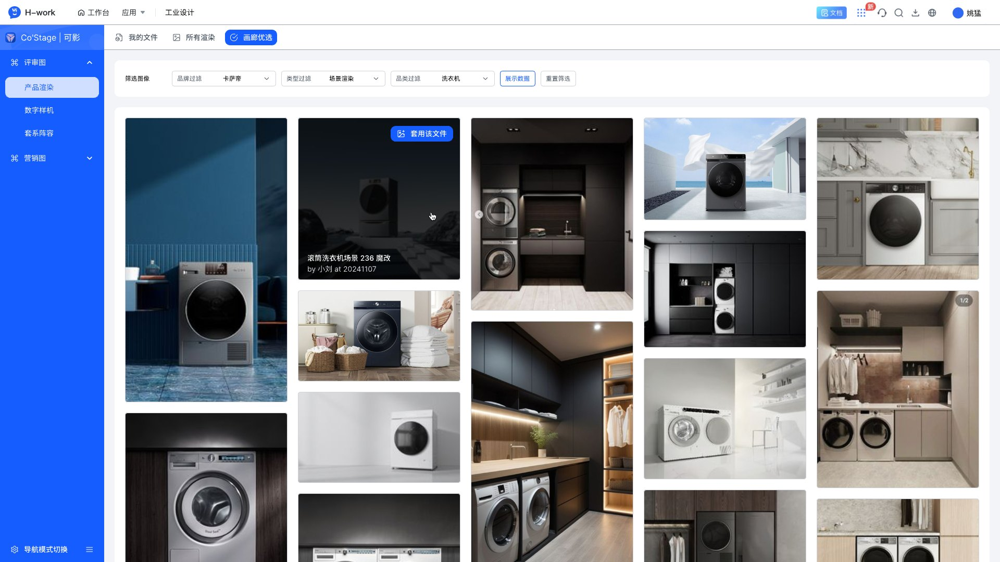

---

## 3. 导入模型

导入是定版主链的第一步。编辑器打开之前，系统必须先拿到一份可在三维编辑器里查看的模型。

### 3.1 用户场景

- 场景 A：设计师手里有产品的 GLB 或 FBX，从「从本地模型创建」选文件，几秒钟后在编辑器里看到未上色的白模或原材质模型，开始调材质。
- 场景 B：她只有零部件的 CAD（如 STP）。系统先走转换，变成可解读的三维格式，再加载进同一套编辑器。转换过程中她需要知道「正在转换、还是失败了」，而不是对着空白编辑器干等。
- 场景 C：模型在 NAS 上，不在本机。从 NAS 选择后，效果与本地导入相同，只是来源不同。

### 3.2 功能描述

- 打开文件对话框支持选择本地（及 NAS）上的模型文件。
- **3D 格式（GLB、FBX）直接进入编辑器。**
- **CAD 格式（如 STP）先转换，再进入编辑器。** 转换是一条正式路径，不是「请用户自己先用别的软件另存为」。
- 导入成功后，编辑器中间画布显示模型，右侧出现场景树（物体层级），左侧默认打开素材中心。
- 沟通原型里，CAD 转换的专门进度页仍是缺口，定版主链必须补上这一环，不能只做「能打开 GLB」。

**原型截图（设计稿 工作台-8，从本地打开文件）**

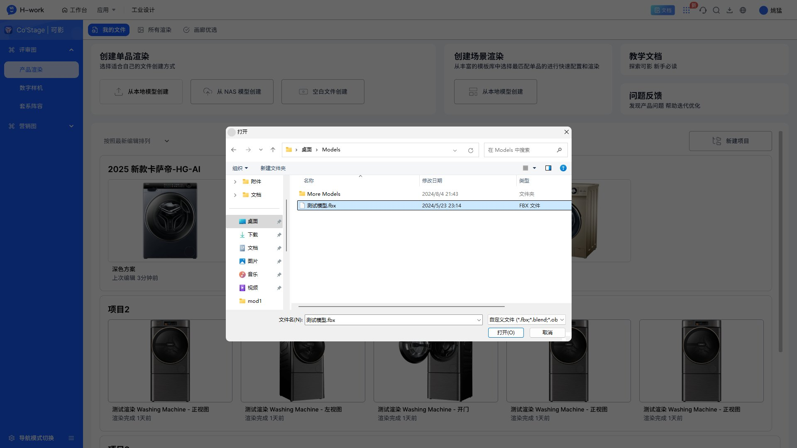

---

## 4. 3D 编辑器总览

编辑器是可影的主工作界面。上下结构固定：左侧仍保留可影导航；中间偏左是「素材中心 / 场景管理」；正中是三维画布；右侧是物体 / 材质 / 环境 / 相机 / 动画面板和场景树；底部是三个主操作：**场景模板、渲染图片、渲染视频**；右下角是方向立方，用来快速转视角。

顶栏显示当前文件名（例如「方案1-文件名字」或已导入的 `xxx.fbx`），可返回工作台。

### 4.1 用户场景

设计师导入一台滚筒洗衣机后，第一眼要在干净背景上看清整机。模型可能还是灰色白模。她用方向立方或鼠标旋转、缩放，从右侧场景树点选「门框」「控制面板」等零件，确认层级是按零件组织的，而不是一个分不开的整包。看清楚之后，再去上材质、套模板、出图。

### 4.2 功能描述

- 中间画布：查看、旋转、缩放、框选或点选零件。未上色时以灰模或原材质显示，不强迫用户先套场景。
- 右侧「物体」页：场景树，按产品零件层级展开（外壳、门、玻璃、旋钮、底座等），可显隐。
- 右侧同时提供材质、环境、相机、动画等页签。动画不是定版主链的必达项，有入口即可，不要挡主路径。
- 左栏可在「素材中心」和「场景管理」之间切换。
- 底部三个按钮始终在：
  - **场景模板**：打开模板选择弹层（见第 7 节）。
  - **渲染图片**：打开渲染导出（见第 9 节）。
  - **渲染视频**：同一位置的视频出图入口；定版主链先锁「多机位效果图」，视频不挡主路径，也不要在未定规格时承诺电影级成片。
- 浏览器预览与「确认后渲染」是两步：先在画布里看对，再提交云端。画布不是成片。

**原型截图（设计稿 工作台-9，编辑器默认态，模型尚未上色）**

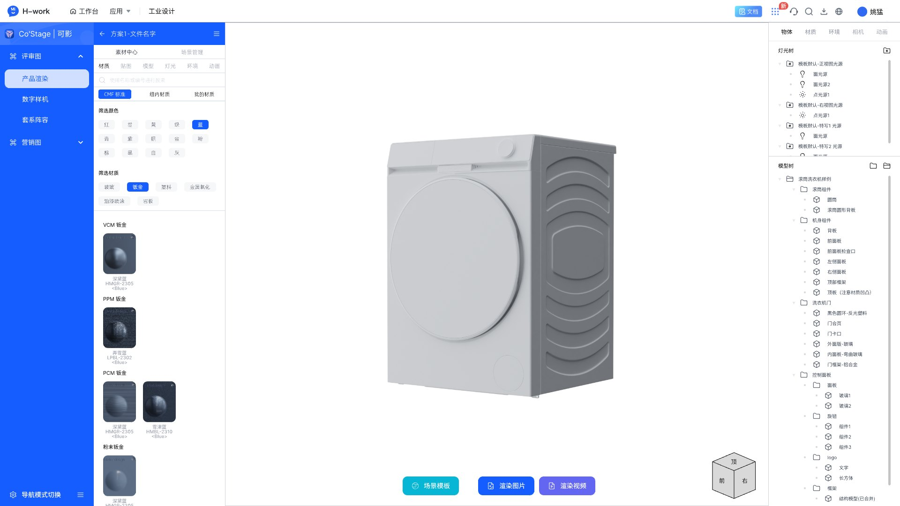

---

## 5. 上材质与贴图

上材质是定版主链里「看清楚产品」之后的第一步改动，也是单品渲染的核心能力。

### 5.1 用户场景

设计师要把一台灰色白模洗衣机，做成「深色金属壳 + 黑色门框 + 玻璃视窗 + 面板 Logo」的深色方案。她的操作顺序通常是：

1. 在右侧场景树或画布上点选「整体面板」或「门框」；
2. 到左侧素材中心，按颜色、材质类型（金属、镀铬、塑料、玻璃等）筛选库里的材质球；
3. 把选中的材质赋到当前零件，画布立即看到变化；
4. 对需要品牌识别的零件，再换成带 Logo、带屏显 UI 贴图的材质，并微调颜色、粗糙度、不透明度。

她希望同一套零件上可以保存多种材质方案（例如深色方案 / 浅色方案），而不是改一次就丢一次。

### 5.2 功能描述

**素材中心（左栏）**

- 分类页签包括材质、装饰、模型、灯光、环境、动画等。主路径先用好「材质」和「装饰 / 贴图」。
- 材质可按筛选条件收窄：颜色（红、蓝、金、银、黑、白等）、材质类型（金属、镀铬、塑料、皮革、玻璃、织物等）。
- 材质球以缩略图 + 名称 + 编号展示，例如「中高亮 HM08-2303」「拉丝金属」这类库内编码。点选即准备赋到当前选中物。

**赋材质（右栏 · 材质）**

- 列出场景中已使用的材质，以及当前选中物体绑定的材质。
- 支持把库中的材质赋到选中零件；画布同步更新。
- 同一零件上可以看到「多种材质」或方案切换（原型右侧有已用材质列表，并可进入参数）。

**贴图与参数**

- 左栏可切换到 Logo、屏显 / 控件 UI、贴图类装饰，把平面资产赋到对应区域（例如面板上的 Haier Logo、窗口 UI）。
- 右栏展开当前材质的参数：基色、粗糙度、不透明度、贴图开关等，允许在库材质基础上做有限微调，不必每次都从零新建材质。
- 微调后的结果应能随文件保存；是否「另存回公共材质库」是另一条管理动作，见第 10 节缺口（材质入库在沟通原型里尚未走通）。

**原型截图（设计稿 工作台-11，已上色，右侧为场景中的材质列表）**

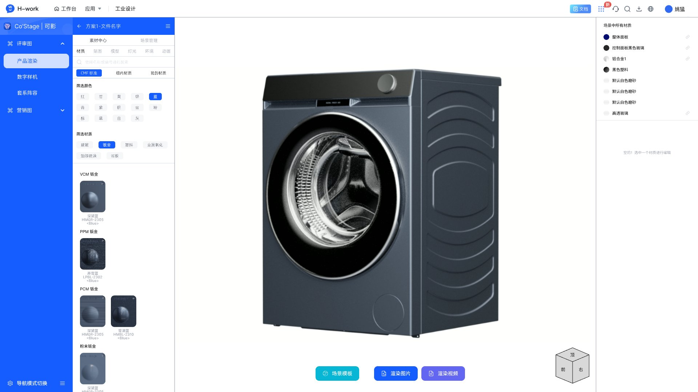

**原型截图（设计稿 工作台-14，Logo / 屏显贴图与右侧材质参数）**

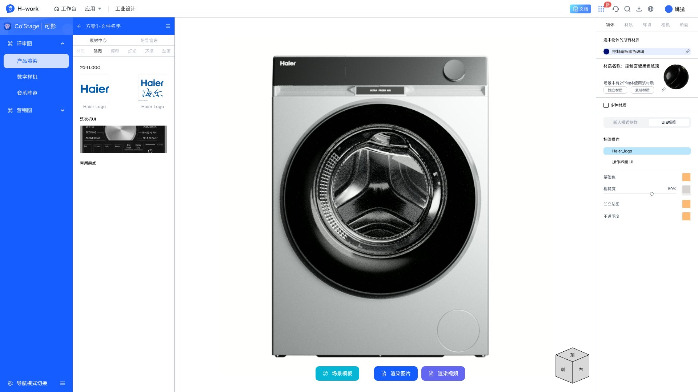

---

## 6. 场景管理（同一场景里的视角预设）

场景管理管的是「这一份已经打开的场景，现在用哪一个已保存的视角看」，不是换另一套空间。

### 6.1 用户场景

设计师已经给洗衣机上好材质，现在要依次检查：

- 标准正视图，看整机比例和门的圆度；
- 左视图，看侧面厚度和进水口；
- 门的特写，看玻璃和内筒；
- 控制面板特写，看 Logo 和旋钮。

她不希望每次都用手把相机拖到大概位置，而是在左侧「场景列表」里点一下对应预设，画布立刻切到那个机位，灯光和环境也可以按预设一起切（如果该视角绑定了自己的灯和环境）。

### 6.2 功能描述

- 左栏切到「场景管理」后，上方是**场景列表**：每个条目是一个已保存视角的缩略图 + 名称（如「模板标准视角-正视图」「特写 1」「特写 2」）。
- 点选某一项，中间画布切到该视角。方向立方仍可用于临时微调，但「正式机位」以列表里的预设为准。
- 「影响保存内容 / 视角」一类开关，用来控制切换或保存时，哪些东西跟着这个视角走，例如：
  - 摄像机
  - 环境光照
  - 物理光源
  - 材质选择（可选，默认不必绑死）
- 右侧场景树里也能看到相机和灯光对象，与左侧列表是同一套数据的不同视图。
- 这些视角稍后会成为「渲染导出」里的多机位候选（见第 9 节）。
- **不要把场景管理做成场景模板入口。** 换空间、换品牌棚，走底部的「场景模板」。

**原型截图（设计稿 工作台-15，场景管理 · 正视图）**

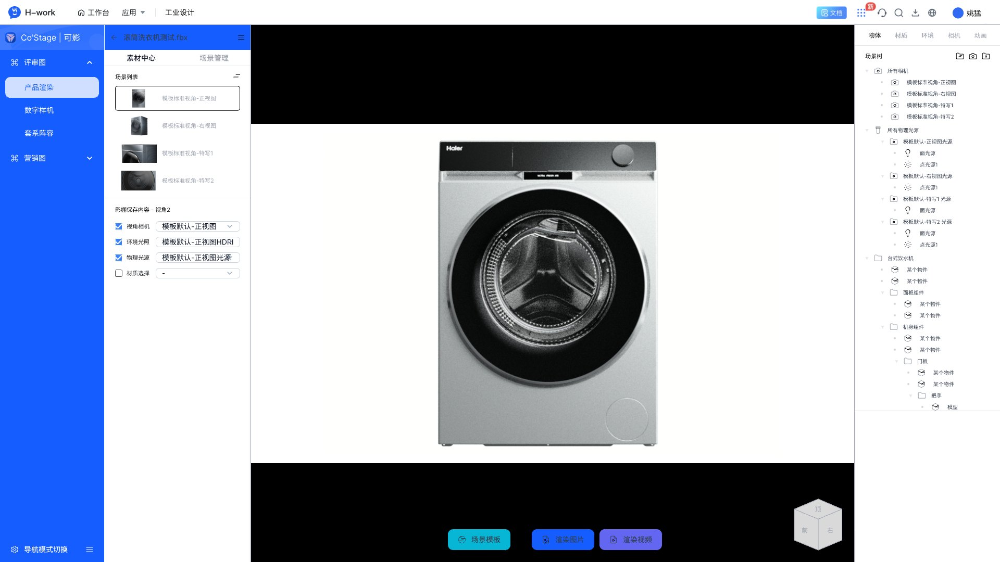

**原型截图（设计稿 工作台-31 / 工作台-32，同一文件切到特写机位）**

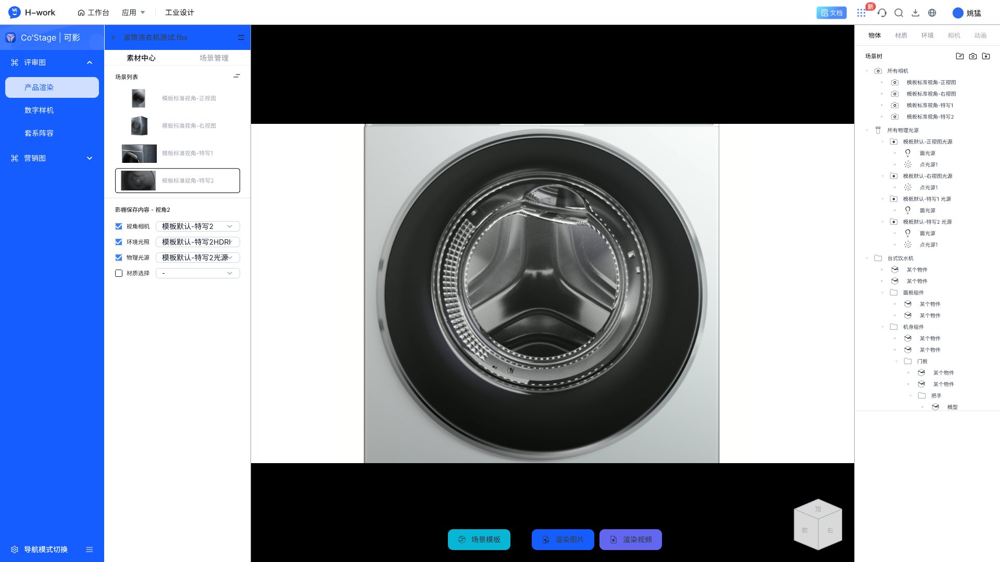

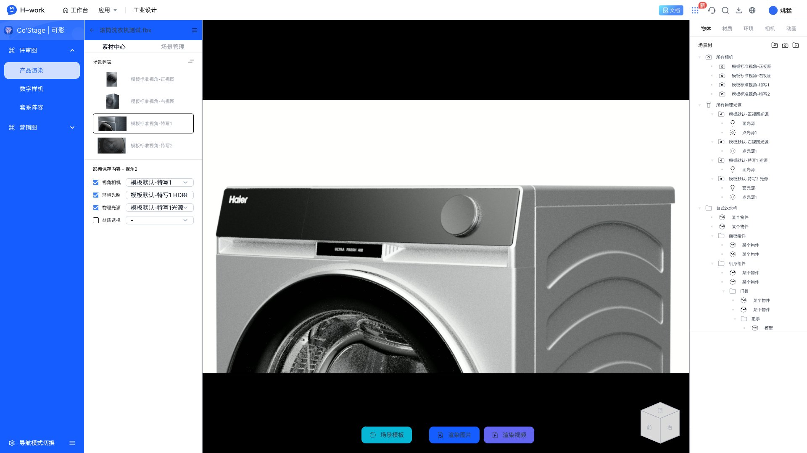

---

## 7. 场景模板（整套壳 + 占位替换）

这是 2026-11-09 明确锁定、必须写进 MuTracer 的能力。场景模板不是背景图，也不是 MuTracer 现在的客厅 preset。

### 7.1 用户场景

设计师已经在单品棚里把材质做对了，现在要把同一台洗衣机放进「灯光 · 暗色调正面」或「简洁空间双机位」这类品牌空间里出图。她点底部「场景模板」，看到按当前项目和产品分类筛过的模板列表，每张卡片都是已经做好的空间效果，带机位说明。

她选中「简洁空间 1-2 机位」后，可以选择：

- **新建文件**：保留当前单品文件，另开一份套了模板的新文件；
- **覆盖当前**：把模板合并进现在这份文件。

确认后，系统进入「场景创建中」，把当前产品放进模板的占位，灯光、相机、环境、视图预设一起过来。完成后，她在编辑器里看到的是「品牌空间里的这台产品」，再用场景管理切换该模板自带的正视图 / 右视图。

### 7.2 功能描述

- 入口：编辑器底部的「场景模板」按钮；在 MuTracer viewer 里，对应右侧新开一栏「场景模板」，不要把「客厅 / 仓库」preset 改名充数。
- 弹层展示：
  - 当前项目、产品分类（用于缩小可选模板范围）；
  - 模板卡片：缩略图、名称、来源（如官方制作）、机位说明（正视图 / 右视图、特写等）。
- 操作：
  - **新建文件**：生成一份新的场景文件，不破坏当前单品文件。
  - **覆盖当前**：在当前文件上合并模板。
- 合并语义（已在本仓库 `tools/scene-template/README.md` 说明，产品侧只需记住结果）：模板是整套壳，用 `replace_id` 标记产品占位；合并后，灯光、相机、环境、视图都随模板走，当前产品替换占位模型。
- 合并过程中要有明确的等待态（「场景创建中」），避免用户以为点了没反应。
- Living Room 等 MuTracer 演示 glTF **没有占位换品**，只能进「房间 / 环境资产库」，给以后做模板壳当素材，不能出现在「场景模板」列表里冒充可换品模板。

**原型截图（设计稿 工作台-29，模板场景弹层）**

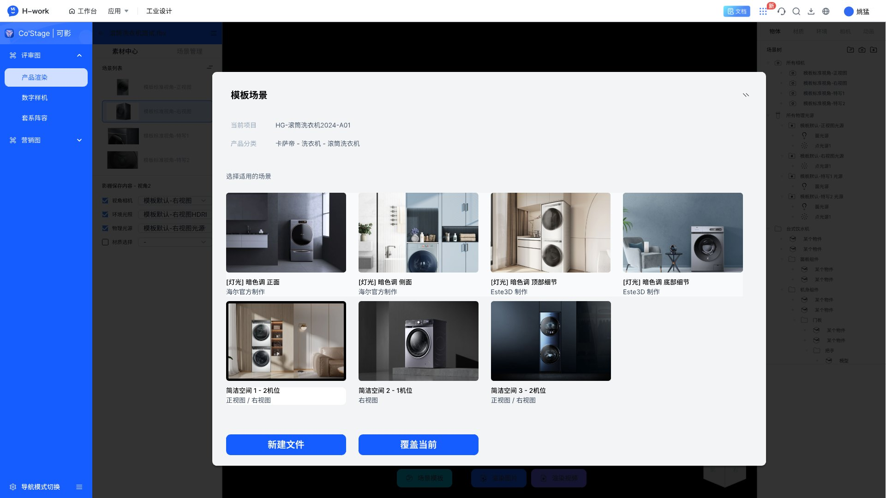

**原型截图（设计稿 工作台-30，场景创建中）**

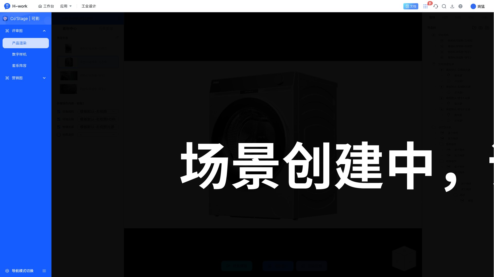

套用场景模板之后，渲染导出里的候选机位也会变成该模板自带的视角（见 16 号图，空间里的双机位效果）。

---

## 8. 布光

布光让设计师在模板光的基础上做有限调整，而不是把可影做成通用三维灯光软件。

### 8.1 用户场景

套用「模板标准视角」后，设计师觉得门把手一侧太暗，看不清镀铬质感。她在右侧场景树选中「面光源」，画布上出现光源的位置和方向辅助线，并按提示在模型上点一个位置作为计算依据；调颜色、亮度、半径、展角后，预览更新。调整只作用于当前视角或当前文件，不直接改公共模板原件。

### 8.2 功能描述

- 右侧可展开灯光对象（环境光、物理光源、面光、点光等），选中后在画布上显示光源辅助线。
- 支持按模型表面拾取点，辅助计算光源位置。
- 可调参数包括颜色、亮度、衰减、半径、展角等（以所选光源类型为准）。
- 提供贴近表面、重置变换一类快捷操作。
- 场景管理里可以把「物理光源 / 环境光照」与某个视角预设绑定，切换视角时一起恢复。
- 定版主链不要求从零搭一套影棚；默认应能直接使用模板或单品标准光，布光是加分微调。

**原型截图（设计稿 工作台-26，在编辑器里调整面光源）**

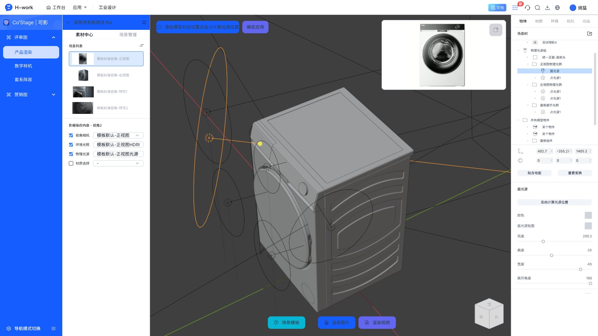

---

## 9. 预览、多机位与渲染导出

这是对外卖法里「云端出图 + 文件可下载」落地的一环，也是定版主链的收口。

### 9.1 用户场景

设计师已经确认：

- 材质是对的；
- 单品棚或品牌空间是对的；
- 正视图、左视图、两张特写这四个机位都是她要出的图。

她点「渲染图片」，在导出弹层里勾选要出的机位（可以不全选），看到每张预览、分辨率和采样说明，点「渲染」。系统按勾选数量生成若干渲染任务，完成后她能在「所有渲染」或本文件里下载效果图。

如果她套的是场景模板，导出列表里出现的是模板自带的空间机位，而不是单品棚的四张标准视图。

### 9.2 功能描述

- 渲染导出弹层展示：当前项目、产品分类；多通道输出选项（全部、物体 ID、材质 ID、基础色、深度等，按实现能力逐步开放，不要假装通道已经齐套）；**多视角输出**缩略图列表。
- 每个视角显示名称、分辨率、采样（原型示例为 1920×1080、2000spp、denoised），可勾选或取消。
- 主按钮是「渲染」，并提示将生成的任务数量。
- 提交后进入云端渲染队列，不占用设计师本机出成片。GPU 调度要在管理侧看得见（合同项），设计师侧至少要看得见任务在排队、进行中、成功或失败。
- 完成后文件可下载。预览画布里的图不能冒充成片。
- 多机位来源就是场景管理里的视角预设，或场景模板自带的机位，不需要导出时再手摆一遍，除非她想临场增补机位。
- 「渲染视频」是并列入口，定版主链不把它当作锁方案的必达项。

**原型截图（设计稿 工作台-36，单品多机位导出）**

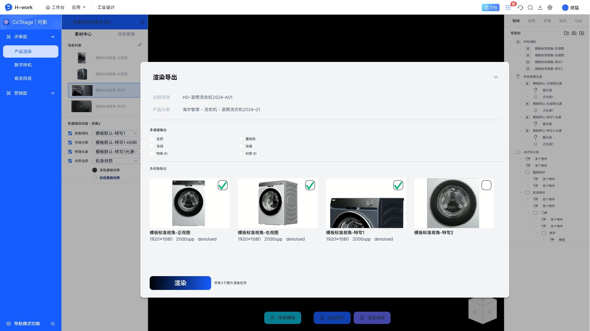

**原型截图（设计稿 工作台-37，套用场景模板后按模板机位导出）**

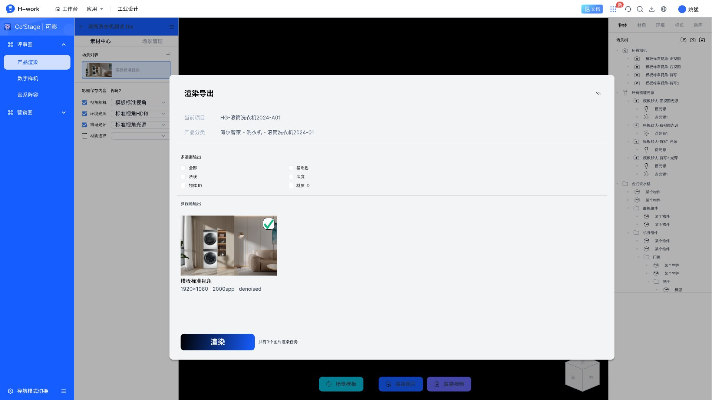

---

## 10. 交付书

交付书把「已经确认的方案」整理成下游（营销、结构、评审）能看懂的一页：左边是方案预览和多机位，右边是部件与材质、颜色、工艺参数表。它属于合同里的「输出与在线评审 / HID」相关能力，**不是本周定版主链的锁点**，但产品形态要先写清，避免后面做成「又一个图库页」。

### 10.1 用户场景

设计师在编辑器里把「方案 A · 深空灰」做完，并渲好正视图、侧视图、45° 和面板特写。她打开这份产品的交付书，把这几张图放在左侧预览区，在右侧核对机身外壳、控制面板、旋钮、门圈等部件的材料、色号、工艺和备注是否与 HID 或内部色板一致，然后导出一份 PDF 发给下游。下游看到的是「图 + 表」，而不是进编辑器自己翻场景树。

### 10.2 功能描述

- 页面结构（沟通后定下来的核心）：**左侧方案预览（可切机位），右侧部件 / 参数表**（材料、颜色 / CMF、工艺、备注等）。点击预览上的热区，应能同步高亮右侧对应零件行；点表也可以反过来定位预览。
- 一份交付书可以对应同一产品下的多个方案（例如方案 A / 方案 B），但当前查看的是其中一个方案。
- 顶部提供 **导出 PDF**。
- **本期不做**：向 HID 回写、在交付书上直接「发布」。下游只读示意可以保留为说明，但不作为本周或近期必须上线的动作。
- 从渲染结果「选入交付书」在沟通原型里仍是缺口，需要在实现时补上，否则设计师只能在交付书里重新找图。

下图来自沟通原型的交付书页。图中仍能看到「回写 HID」「发布」以及方案 A/B 切换——那是更早一版界面的完整态。**请按本节的取舍理解：左右分栏和参数表保留，发布与回写本期不做。**

**原型截图（沟通原型交付书页）**

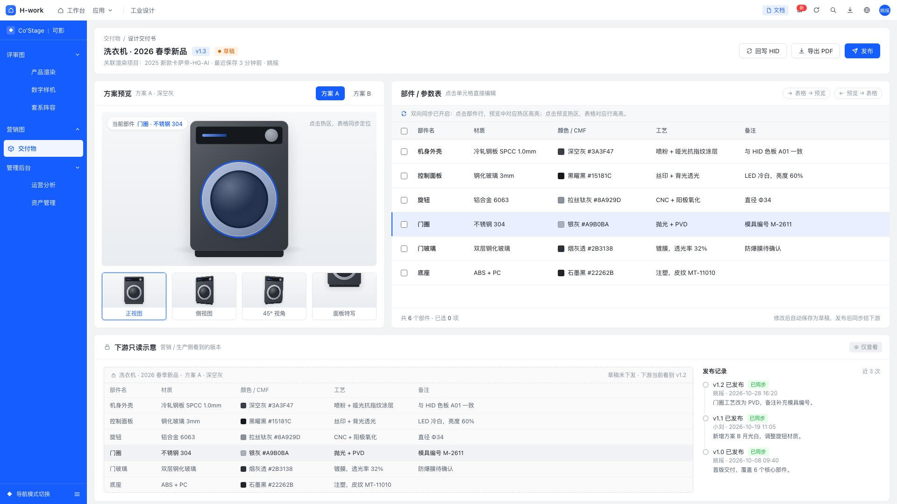

---

## 11. 资产管理

资产管理是公共库，不是「我的文件」。设计师和资产管理员在这里维护可以反复使用的单品模板、场景模板、材质、贴图、模型、灯光、环境和动画。

### 11.1 用户场景

资产管理员要把一款新的卡萨帝滚筒「单品模板」入库，供工作台「从模板创建」和画廊套用。她在「单品模板管理」里上传，填写可见组、所属品牌、责任人，上传成功后状态为正常；如果文件有问题则标异常，便于下架或重传。

设计师通常只在编辑器的素材中心里消费这些库，不必每天进这张管理表。但「保存为模板 / 材质入库」如果要对他人可见，最终会落到这里。

### 11.2 功能描述

- 顶部是资产类别页签：单品模板、场景模板、材质、贴图、模型、灯光、环境、动画。
- 列表字段包括：缩略图、名称、可见组、所属品牌、上传时间、文件大小、状态（正常 / 异常）、责任人、操作与备注。
- 支持上传新资产。可见范围按组或品牌控制，不能默认变成全公司未分级共享（具体权限模型跟合同「管理运维安全 / 资产元数据」走）。
- 「保存当前文件为模板」「复制项目」「把当前微调材质写入公共库」在沟通原型里尚未走通，实现时要接到本页，而不是另做一套私下目录。

**原型截图（沟通原型 · 单品模板管理）**

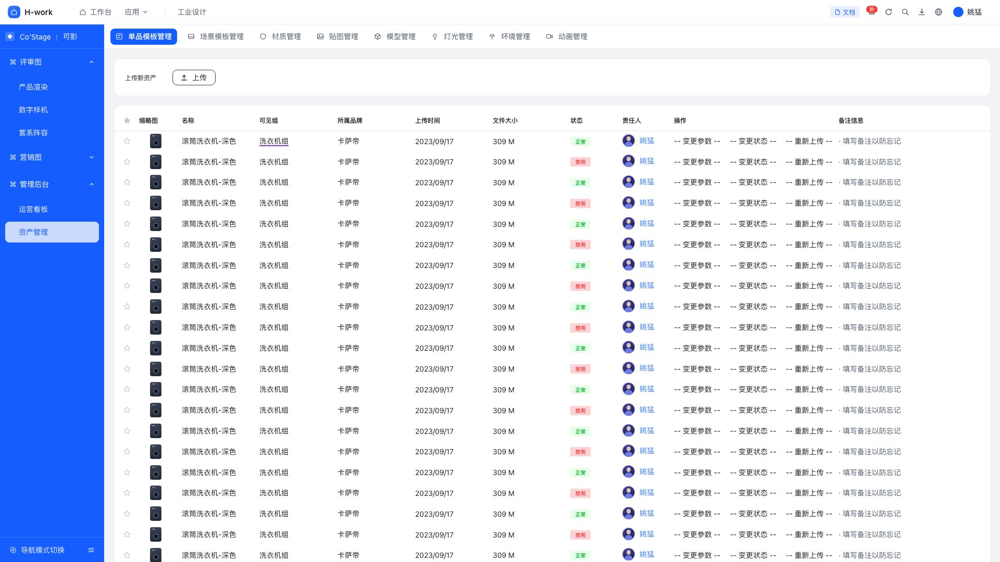

---

## 12. 运营与管理看板

这是给运营 / 管理者看用量的页面，不是设计师主路径，但对应合同里的「管理运维安全」和「GPU 调度要看得见」。

### 12.1 用户场景

管理者要看本周各小组渲了多少次、多少人在用、交互渲染和离线渲染各耗了多少小时、GPU 成本大概多少，并按部门或人员排序，判断是不是某组把队列占满了。

### 12.2 功能描述

- 页签区分数据看板和图像看板（图像看板细节以实现时为准）。
- 可按时间范围、组织筛选。
- 汇总卡片：总渲染次数、使用软件的人数、交互渲染总时长、离线渲染总时长、累计 GPU 或成本。
- 图表按小组或人员展示次数、使用率、时长排行。
- 这里要能支撑「GPU 调度可视」，不要只做一张很好看但连不上真实队列的装饰图。

**原型截图（沟通原型 · 运营看板）**

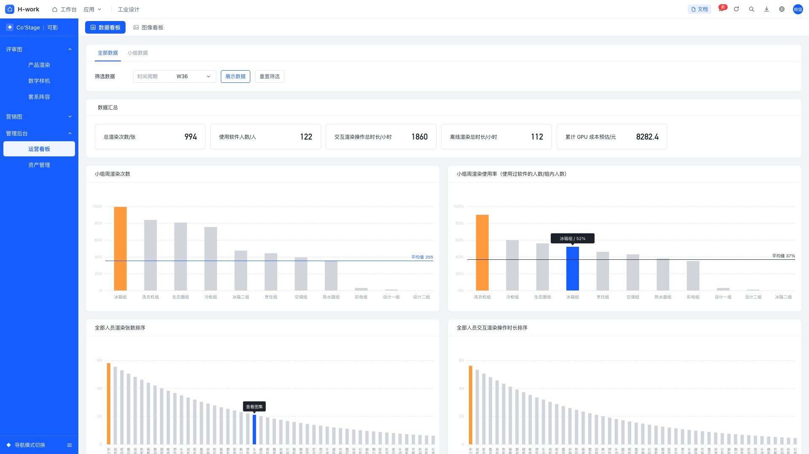

---

## 13. AI 助手在产品里的位置

合同包含 AI Agent / MCP。沟通原型里，助手不是另做一条独立产品，而是挂在三条已有路径上：

1. **工作台入口**：创建文件、找历史、套用画廊时提供建议或代填；
2. **编辑器助手**：在上材质、选模板、摆机位时提供辅助，但不能代替设计师确认后再渲染；
3. **交付书**：帮助核对参数表、整理导出说明。

本期不要把 Agent 设计成「一句话自动出全套成片并直接发布」。主路径仍然是人在编辑器里确认，再交云端出图。

---

## 14. 合同 13 项与定版主链的对照

下面只做对照，方便后续 agent 排期时不把两层验收写进同一行。VR 本期明确不做。

| 合同项 | 产品上主要落在哪 | 和本周定版主链的关系 |
| --- | --- | --- |
| 规划设计 | 本文件及后续正式设计说明 | 文档与方案本身 |
| HWork | 顶栏所在的 Hi-work 工作台宿主 | 可影是其中的一个应用，定版主链不重做宿主 |
| HID | 交付书与色板 / 参数来源；回写本期不做 | 不挡定版主链 |
| 输出与在线评审 | 渲染导出、所有渲染、交付书、导出 PDF | 导出效果图是定版必达；交付书完整评审流不是本周锁点 |
| 资产元数据 | 资产管理各库的字段、品牌、可见组、状态 | 主链先能用库；完整治理后续补 |
| 工作台 | 我的文件 / 所有渲染 / 画廊优选 | 要能进编辑器、能看到渲完的图 |
| CAD | CAD 转换后再进编辑器，并有进度反馈 | **定版主链必达** |
| Web3D 工作台 | 3D 编辑器（查看、材质、模板、机位、布光） | **定版主链必达** |
| 渲染引擎 | 浏览器预览 + 云端成片；成片不宣称已替代 Blender | **定版主链必达**；需对照金样查噪点 |
| GPU 调度 | 任务队列可视、运营看板上的时长与占用 | 至少让提交、排队、完成可被看到 |
| VR | 本期不做 | 不要排进定版 |
| AI Agent / MCP | 工作台、编辑器、交付书三处挂点 | 不挡主链，不做自动发布 |
| 管理运维安全 | 登录与权限、资产可见范围、运营看板 | 要有基本权限，不做完也不要裸奔上生产 |

---

## 15. 已知缺口（实现时不要当成「已经有了」）

以下来自 2026-11-06《需求原型缺口对照》，以及 2026-11-09 对主链的加严。沟通原型把主路径点亮了，但这些步骤仍缺界面或仍缺真实闭环：

1. **单品模板的完整使用链**：从库里的单品模板真正生成一份可编辑文件，而不只是工作台上有按钮。
2. **CAD 转换进度页**：转换中、成功、失败都要有状态，失败要能重试或换文件。
3. **所有渲染的任务态**：排队中、渲染中、失败重试，不能只展示已经成功的漂亮图。
4. **选入交付书**：从渲染结果把指定机位送进交付书预览区。
5. **保存为模板 / 复制项目 / 材质入库**：设计师侧的生产结果要能合法回到资产管理。
6. **MuTracer 场景模板栏**：按第 7 节在 viewer 右侧新开「场景模板」，合并 `replace_id`；现有客厅 preset 只进环境资产库。
7. **官方脚本与预览的分工**：预览用于确认，成片走云端；对照 Blender 金样查噪点是引擎还是参数问题。

另外，侧栏「数字样机 / 套系阵容 / 营销图」保持不做；交付书的发布、回写 HID 本期不做。

---

## 16. 术语表

| 用语 | 含义 |
| --- | --- |
| 可影 / CoStage | 本产品，工业设计师用的在线可视化工作台 |
| 定版方案 / 定版主链 | 本周要锁住的技术主路径，见 1.3；不是合同 13 项的全部 |
| 单品渲染 | 拍产品本体，标准机位和灯光 |
| 场景渲染 | 把产品放进品牌空间再渲 |
| 场景模板 | 带产品占位（`replace_id`）的整套壳，合并后灯、相机、环境、视图随模板 |
| 场景管理 | 同一份场景里切换已保存的视角预设 |
| 房间 / 环境资产 | 没有占位换品能力的空间模型，例如 MuTracer 的 Living Room |
| GLB / FBX | 可直接进入编辑器的三维格式 |
| CAD / STP | 需先转换再进入编辑器的设计格式 |
| 预览 | 浏览器里用于确认的画面 |
| 成片 | 确认后云端渲染出来的可下载效果图 |
| 交付书 | 方案预览 + 部件参数表，可导出 PDF |
| HID | 产品色板 / 部件参数的业务系统；本期只引用，不回写 |
| Motus | POC 完成后再做的 3D 编辑器微调平台，非本周范围 |

---

## 17. 附图索引

截图由 2026-11-05 设计稿 `refs/工作台-*.png` 及沟通原型实拍页压缩为 JPEG，放在本目录 `images/` 下，方便在 Git 里直接预览。原图仍以设计稿目录为准。

| 文件 | 对应设计稿 / 原型 | 说明 |
| --- | --- | --- |
| `images/01-workbench-files.jpg` | 工作台.png | 我的文件 |
| `images/02-workbench-renders.jpg` | 工作台-4.png | 所有渲染 |
| `images/03-workbench-gallery.jpg` | 工作台-5.png | 画廊优选 |
| `images/04-create-project-dialog.jpg` | 工作台-7.png | 创建项目弹层 |
| `images/05-open-local-file.jpg` | 工作台-8.png | 从本地打开模型 |
| `images/06-editor-default.jpg` | 工作台-9.png | 编辑器默认（未上色） |
| `images/07-editor-materials-applied.jpg` | 工作台-11.png | 已上材质 |
| `images/08-editor-texture-params.jpg` | 工作台-14.png | 贴图与材质参数 |
| `images/09-editor-scene-views.jpg` | 工作台-15.png | 场景管理 · 正视图 |
| `images/10-editor-lighting.jpg` | 工作台-26.png | 布光 |
| `images/11-scene-template-picker.jpg` | 工作台-29.png | 场景模板弹层 |
| `images/12-scene-creating.jpg` | 工作台-30.png | 场景创建中 |
| `images/13-scene-view-closeup.jpg` | 工作台-31.png | 场景管理 · 特写 |
| `images/14-scene-view-detail.jpg` | 工作台-32.png | 场景管理 · 面板特写 |
| `images/15-render-export-multicam.jpg` | 工作台-36.png | 单品多机位导出 |
| `images/16-render-export-scene-cam.jpg` | 工作台-37.png | 模板机位导出 |
| `images/17-assets-product-templates.jpg` | 原型 assets 页 | 单品模板管理 |
| `images/18-briefing.jpg` | 原型 briefing 页 | 交付书（含已裁掉的发布 / 回写，以第 10 节为准） |
| `images/19-ops-dashboard.jpg` | 原型 admin 页 | 运营看板 |

如需打开可点击的沟通原型，本地文件在：

`/Users/wangjianzheng/Doc/dyson/costage-proto-v2-pixel/`

其中 `home.html`、`editor.html`（可用 `#9` `#11` `#14` `#15` `#26` `#29` `#30` 等 hash 切状态）、`assets.html`、`briefing.html`、`admin.html`、`journey.html`。
